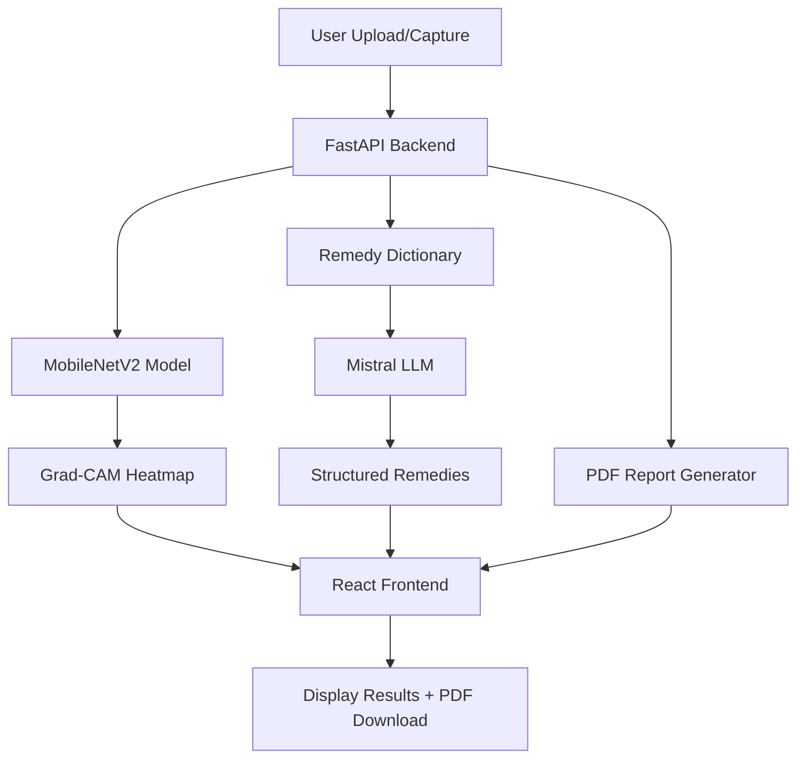

# KrishiVision — AI Crop Disease Detector

A web application for detecting crop diseases from plant leaf images using deep learning. Upload or capture a leaf photo to receive:
1. **Crop species + disease diagnosis** with confidence scores
2. **Grad-CAM heatmap** showing which leaf regions drove the prediction
3. **Treatment remedies** in English/Hindi/Marathi from an LLM grounded in a curated dictionary
4. **Exportable PDF report** with diagnosis, heatmap, and remedies

## Architecture



## Quick Start

### Prerequisites
- Python 3.11+
- Node.js 18+
- Kaggle API credentials (for dataset download)

### Backend Setup
```bash
cd backend
python -m venv venv
source venv/bin/activate
pip install -r ../requirements.txt
cp .env.example .env  # Add MISTRAL_API_KEY
uvicorn main:app --reload
```

### Frontend Setup
```bash
cd frontend
npm install
npm run dev
```

### Training Pipeline (Colab T4)
Open `notebooks/training_pipeline.ipynb` in Google Colab with T4 GPU runtime.

## Project Structure
```
krishivision/
├── backend/
│   ├── main.py                 # FastAPI app + endpoints
│   ├── config.py               # paths, thresholds, language codes
│   ├── ml/
│   │   ├── train_baseline.py   # Phase 1: frozen base training
│   │   ├── train_finetune.py   # Phase 2: unfreeze last 30 layers
│   │   ├── augment.py          # augmentations + GrabCut background replacement
│   │   ├── gradcam.py          # Grad-CAM heatmap generation
│   │   ├── evaluate.py         # dual evaluation: lab vs field
│   │   └── export_tflite.py    # int8 quantization → model.tflite
│   ├── remedies/
│   │   ├── remedy_dictionary.json
│   │   └── llm_remedy.py       # Mistral API + fallback
│   ├── reject.py               # non-leaf detection + confidence threshold
│   └── pdf_report.py           # ReportLab PDF generation
├── frontend/
│   ├── src/
│   │   ├── components/         # UploadCapture, ResultCard
│   │   └── api.js              # API calls
│   └── ...
├── notebooks/
│   └── training_pipeline.ipynb # Colab-ready training
├── tests/
│   ├── test_api.py
│   ├── test_reject.py
│   └── e2e_smoke.py
└── docs/
    └── architecture.md
```

## Results (Expected)

| Metric | PlantVillage (Lab) | PlantDoc (Field) |
|--------|-------------------|------------------|
| Accuracy | ~95% | ~75% |
| Macro F1 | ~0.94 | ~0.72 |

## References
- PlantVillage Dataset: [Kaggle](https://www.kaggle.com/datasets/abdallahalidev/plantvillage-dataset)
- PlantDoc Dataset: [GitHub](https://github.com/pratikkayal/PlantDoc-Object-Detection-Dataset)
- Grad-CAM: arXiv:2206.04374
- MobileNetV2: arXiv:1801.04381